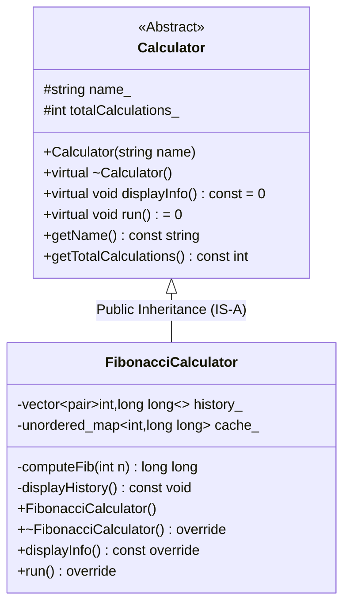

# Case Study: Object-Oriented Fibonacci Calculator in C++

**Course:** Object-Oriented Concepts (OOC / OOP in C++)  
**Semester:** Third Semester (Second Year Computer Engineering)  
**Project:** Fibonacci Calculator Framework  
**Standard:** C++17  

---

## 1. Introduction

The Fibonacci sequence is defined by the recurrence relation:
$$F(0) = 0, \quad F(1) = 1, \quad F(n) = F(n-1) + F(n-2) \quad (n \ge 2)$$

While standard textbook examples use naive recursion, they suffer from exponential time complexity $\mathcal{O}(2^n)$, rendering them unusable for $n \ge 45$. Furthermore, arithmetic limits must be addressed: in a signed 64-bit integer (`long long`), $F(92) = 7,540,113,804,746,346,429$ is the maximum representable Fibonacci number. Computing $F(93)$ exceeds `LLONG_MAX` ($9.22 \times 10^{18}$) and causes integer overflow.

This project implements an extensible, object-oriented framework in C++17 that computes Fibonacci numbers up to $F(92)$ in $\mathcal{O}(n)$ time via memoization, tracks session history, and enforces robust input validation.

---

## 2. Main Idea & System Architecture

Rather than writing a monolithic script, the system decouples the **generic calculator interface** from the **domain-specific computation engine**. Following the **Open-Closed Principle (OCP)**, client code interacts with an abstract base class, allowing other mathematical engines (e.g., Prime or Factorial calculators) to be added without modifying existing code.



---

## 3. Classes and Member Functions

### 3.1 Abstract Base Class: `Calculator`
Defined in `Calculator.hpp`, this class serves as the interface contract.

- `protected: std::string name_`: Stores the calculator name.
- `protected: int totalCalculations_`: Tracks operations completed during the session.
- `explicit Calculator(const std::string& name)`: Constructor initializing common base attributes via a member initializer list. Marked `explicit` to prevent implicit string-to-calculator conversions.
- `virtual ~Calculator()`: Virtual destructor ensuring safe cleanup through base pointers.
- `virtual void displayInfo() const = 0`: Pure virtual function enforcing custom documentation in subclasses.
- `virtual void run() = 0`: Pure virtual function defining the interactive application lifecycle.
- `std::string getName() const` & `int getTotalCalculations() const`: Encapsulated read-only accessors marked `const`.

### 3.2 Derived Class: `FibonacciCalculator`
Defined in `FibonacciCalculator.hpp`, publicly inherits from `Calculator`.

- `private: std::unordered_map<int, long long> cache_`: Hash table storing computed values for $\mathcal{O}(1)$ amortized retrieval.
- `private: std::vector<std::pair<int, long long>> history_`: Dynamic array logging `(n, F(n))` history for the session.
- `private: long long computeFib(int n)`: Internal recursive helper utilizing top-down memoization.
- `private: void displayHistory() const`: Internal helper formatting past calculations.
- `public: FibonacciCalculator()`: Constructor that delegates to `Calculator("Fibonacci Calculator")` and seeds base cases $F(0)=0, F(1)=1$.
- `public: ~FibonacciCalculator() override`: Derived destructor that logs session statistics and releases resources.
- `public: void displayInfo() const override`: Displays mathematical definitions, recurrence formulas, and the Golden Ratio ($\phi \approx 1.618$).
- `public: void run() override`: Executes the interactive input loop, input sanitization, and error handling.

---

## 4. Header Files (`.hpp`) vs. Source Files (`.cpp`)

The codebase separates declarations from implementations:

1. **Separation of Concerns:** Header files (`.hpp`) declare class structure, member variables, and function prototypes (the *public contract*). Implementation files (`.cpp`) contain the actual algorithmic code.
2. **Include Guards:** Headers use preprocessor directives (`#ifndef`, `#define`, `#endif`) to prevent duplicate definition errors (**One Definition Rule / ODR**) when included in multiple translation units.
3. **Compilation Efficiency:** Modifying algorithmic logic in `FibonacciCalculator.cpp` only requires recompiling that single translation unit, leaving other modules unaffected.

---

## 5. Constructors and Destructors Lifecycle

### 5.1 Construction Order & Initializer Lists
When creating an instance via `std::make_unique<FibonacciCalculator>()`:
1. **Base Class Constructor (`Calculator`)** runs first, directly initializing `name_` and `totalCalculations_` using a member initializer list.
2. **Derived Class Constructor (`FibonacciCalculator`)** runs second, seeding `cache_[0] = 0` and `cache_[1] = 1`.

### 5.2 Critical Need for Virtual Destructors
In polymorphic code, objects are managed through base pointers:
```cpp
std::unique_ptr<Calculator> calc = std::make_unique<FibonacciCalculator>();
```
If `Calculator::~Calculator()` were not declared `virtual`, deleting `calc` would only trigger the base destructor. The derived destructor `~FibonacciCalculator()` would be skipped, leaking resources and skipping cleanup code.

By declaring `virtual ~Calculator()`, the compiler uses the **virtual method table (`vtable`)** to ensure late binding:
1. `~FibonacciCalculator()` executes first (clearing caches, printing final statistics).
2. `~Calculator()` executes second (releasing base resources).

---

## 6. Implementation of Core OOP & Modern C++ Concepts

| Concept | Implementation in Project | Practical Significance |
| :--- | :--- | :--- |
| **Abstraction** | Pure virtual functions (`displayInfo() = 0`, `run() = 0`) make `Calculator` an abstract class. | Defines a strict interface contract; cannot be accidentally instantiated. |
| **Encapsulation** | Caches and history are `private`; base fields are `protected`; getters are `public`. | Hides internal implementation details; protects calculation history from corruption. |
| **Inheritance** | `class FibonacciCalculator : public Calculator` | Establishes an `IS-A` relationship, allowing derived classes to reuse base functionality. |
| **Polymorphism** | Dynamic dispatch via `calc->run()` using base pointer `std::unique_ptr<Calculator>`. | Resolves derived methods at runtime via the `vtable`, enabling plug-and-play extensibility. |
| **RAII & Smart Pointers** | `std::unique_ptr<Calculator>` with `std::make_unique` in `main.cpp`. | Automatic heap memory deallocation when going out of scope; eliminates raw `new`/`delete` leaks. |
| **STL Containers** | `std::unordered_map` for cache; `std::vector<std::pair>` for history. | Provides industrial-strength, memory-managed data structures. |
| **Exception Handling** | `try-catch` blocks catching `std::invalid_argument` and `std::out_of_range`. | Defensively catches non-numeric input and values exceeding 64-bit limits without crashing. |
| **Const Correctness** | `displayInfo() const`, `getName() const` | Compiler-enforced immutability prevents unintended object state mutations. |

---

## 7. Algorithmic Optimization: Memoization

The internal `computeFib(int n)` method replaces naive $\mathcal{O}(2^n)$ recursion with top-down dynamic programming:

```cpp
long long FibonacciCalculator::computeFib(int n) {
    auto it = cache_.find(n);
    if (it != cache_.end()) return it->second; // O(1) Cache Hit

    long long val = computeFib(n - 1) + computeFib(n - 2);
    cache_[n] = val; // Store for future calls
    return val;
}
```

- **Time Complexity:** $\mathcal{O}(n)$ on first evaluation; $\mathcal{O}(1)$ for previously queried numbers.
- **Space Complexity:** $\mathcal{O}(n)$ auxiliary space to store cached results.
- **Input Guard:** Rejects $n < 0$ and $n > 92$, guaranteeing computations never wrap around or overflow signed 64-bit integers.

---

## 8. Sample Execution Trace

```text
[Session] Fibonacci Calculator created.
[Init] Cache seeded with F(0)=0 and F(1)=1.

=== FIBONACCI CALCULATOR ===
Recurrence:  F(n) = F(n-1) + F(n-2) | Base cases: F(0) = 0, F(1) = 1
Golden Ratio (phi) = 1.6180339887

n = 10
>>> F(10) = 55
Session History (1 calculation):
  1. F(10) = 55

n = 92
>>> F(92) = 7540113804746346429

n = 93
[!] F(93) overflows 64-bit. Max n = 92.

n = q
Goodbye! Total calculations: 2

[Destructor] ~FibonacciCalculator() called.
[Destructor] Session: 2 calculation(s).
[Session] Fibonacci Calculator base resources released.
```

---

## 9. Conclusion

This project demonstrates how core C++ Object-Oriented Programming principles—**abstract base classes, virtual destructors, dynamic dispatch, encapsulation, and smart pointers**—turn a simple mathematical sequence into a scalable, production-grade application. By coupling clean architectural patterns with memoized dynamic programming, the application achieves both maximum algorithmic efficiency and reliable numerical safety.
